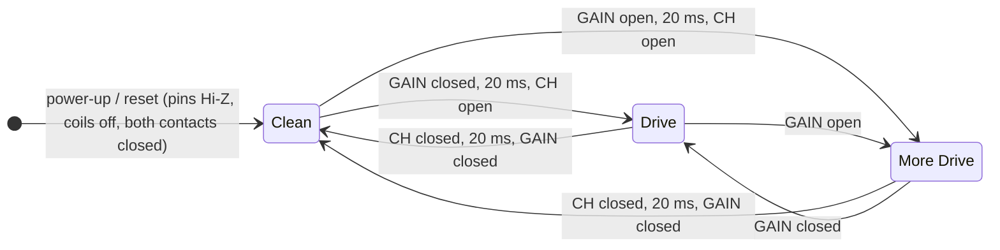
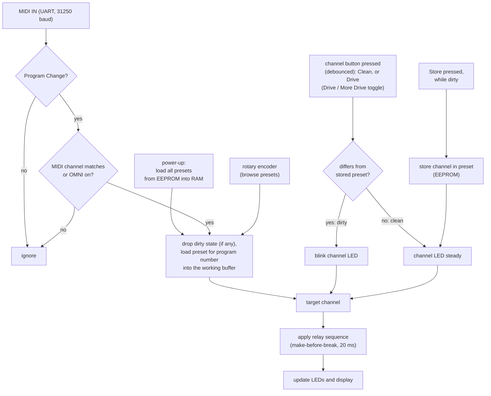

# fenderswitch

A programmable, MIDI-controllable channel switcher for Fender™ Hot Rod Deluxe and Deville guitar amps.

## Overview

These amps ship with a simple footswitch for picking one of three channels: **Clean**, **Drive** and **More Drive**. The footswitch connects over a plain mono (TS) cable, and the amp selects the channel based on the voltage it sees on that cable.

fenderswitch replaces that footswitch. Two small 5 V signal relays recreate the analog switching of the original pedal:

- **Relay 1 (channel)** switches between **Clean** and **Drive**.
- **Relay 2 (gain)** chooses between **Drive** and **More Drive**.

On the microcontroller side, each relay is just a digital output pin driven HIGH or LOW, through a BC548C transistor stage.

### Front panel

There are two momentary push buttons for the channels. **Clean** selects Clean. **Drive** selects Drive when coming from Clean; after that, each press toggles between More Drive and Drive. An LED next to each button shows which channel is active; Drive and More Drive share a red/green duo LED:

| Channel    | LED                        |
|------------|----------------------------|
| Clean      | green                      |
| Drive      | duo LED yellow (red + green) |
| More Drive | duo LED red                |

### Presets and MIDI

The microcontroller's EEPROM holds up to **128 presets**, one per MIDI program number. A MIDI IN circuit feeds the microcontroller's UART. When the device receives a **MIDI Program Change**, it loads the preset stored for that program and switches the amp to that channel. This lets you control the amp from an external MIDI pedal or a multi-effects board.

At boot, all presets are loaded from EEPROM into RAM, so switching programs never waits for the EEPROM. Preset *n* is stored in EEPROM byte *n* (bytes 0–127). Byte 128 holds the MIDI setting (0 = OMNI, 1–16 = channel), byte 129 the display brightness (0–7); the bytes above are free.

All programs start out as **Clean**, the factory preset. You change a preset with the channel buttons and store it by pressing **Store** (see [Usage](#usage)).

### Display and controls

An internal 4-digit 7-segment display (TM1637, with a colon) shows the current program number with the channel in front of it, and the settings menu for the MIDI channel (or OMNI mode) and the display brightness. A rotary encoder with a built-in push button lets you move through the menus and browse quickly through the presets. The **Store** button next to it saves a modified preset, and in the menu it confirms a setting and writes it to EEPROM.

## Features

- Recreates the amp's original 3-channel footswitch using two isolated signal relays
- Two channel buttons (Clean, Drive / More Drive) with a green LED and a red/green duo LED
- 128 presets stored in EEPROM, edited directly with the channel buttons
- MIDI IN: Program Change recalls the matching preset
- Configurable MIDI channel and OMNI mode
- 4-digit 7-segment display with menus, navigated by a rotary encoder with a push button
- Store button: saves a modified preset with one push, confirms settings in the menus
- Fail-safe: the relays use their normally closed contacts, so the amp sees Clean whenever the microcontroller is in reset, booting or unpowered

## How the amp's footswitch line works

The amp sends about 27 VAC through an 820 Ω resistor onto the tip of its FOOT SWITCH jack. Each half-cycle carries one piece of information:

- The **positive half-cycle** selects the **channel** (Clean or Drive).
- The **negative half-cycle** selects the **gain** (Drive or More Drive).

Whatever is plugged in clamps each half-cycle either to about one diode drop or leaves it open, in which case zener diodes inside the amp clamp it at about ±10 V. The amp measures the two peak voltages at test points TP32 and TP35 and decides with two comparators. In Clean mode the amp ignores the gain half-cycle, because transistor Q4 locks out More Drive while the Normal channel is active.

fenderswitch works like the amp's front-panel switches: a 1N4148 steering diode sends each half-cycle to its own relay contact, and the contact either shorts that half-cycle to the sleeve or leaves it open. This gives the largest noise margins of all switching methods. The original footswitch's LEDs, diodes and zener only reproduce these two levels; without the LEDs, two plain contacts are all that's left.


Both relays are wired with their **normally closed (NC)** contacts: a relay at rest shorts its half-cycle, an energized relay opens it. With both coils off the amp sees Clean.

Source: Fender schematic 050384 rev. B and footswitch assembly 050419. The voltages below are derived from the schematic and should be measured on your own amp.

## Hardware

| Ref. | Component | Notes |
|------|-----------|-------|
| | Arduino Nano (ATmega328P) | CH340 clone with the old bootloader (uploads at 57600 baud), runs at 5 V |
| | 4-digit 7-segment display with colon, TM1637 module | CLK/DIO two-wire bus (not I2C) |
| | Rotary encoder with push button | Bare 5-pin mechanical encoder (EC11 style) |
| R × 3 | 10 kΩ | Encoder: pull-ups from A, B and SW to 5 V |
| | LED, green | Clean indicator, with a series resistor |
| | Duo LED red/green, common cathode, 3 pins | Drive (yellow) and More Drive (red) indicator, one series resistor per die. The shade of yellow is set in firmware by PWM (`DUO_YELLOW_RED`, `DUO_YELLOW_GREEN` in [DuoLed.hpp](include/DuoLed.hpp)) |
| | 3 × momentary push button | Clean, Drive (toggles Drive / More Drive) and Store next to the encoder. Wired to GND, using the internal pull-ups, debounced in firmware |
| K1, K2 | 5 V signal relay with gold-plated contacts, 1 form C (SPDT) | E.g. Omron G5V-1, Panasonic TQ2-5V, Hongfa HFD2. K1 = channel, K2 = gain. Only the NC contact is used |
| Q × 2 | BC548C | Low-side coil driver, 100 mA max |
| R_B × 2 | 1 kΩ | GPIO to base, about 4.3 mA base current |
| R_PD × 2 | 10 kΩ | Base to GND, keeps the coil off while the pin is Hi-Z |
| D_F × 2 | 1N4148 | Flyback diode across each coil, cathode to +5 V |
| D1, D2 | 1N4148 | Half-cycle steering. D1 anode to tip, D2 cathode to tip |
| TVS | SMBJ15CA (bidirectional) | ESD and plug-in transients across tip and sleeve |
| J | 5-pin DIN socket (180°) | MIDI IN |
| U | H11L1 or Sharp PC900V | MIDI optocoupler with Schmitt-trigger output, isolates the MIDI sender's ground. Same pinout: 1 anode, 2 cathode, 4 V_O, 5 GND, 6 V_CC |
| R × 2 | 220 Ω, 10 kΩ | MIDI: 220 Ω in series with the opto LED, 10 kΩ output pull-up to 5 V (keep it weak, see [Sharing the UART](#sharing-the-uart-with-usb)) |
| D | 1N4148 | MIDI: across the opto LED, against reverse voltage |
| C | 100 nF | MIDI: optocoupler decoupling, close to pin 6 |
| | Mono (TS) jack (6.35 mm) | Goes to the amp's footswitch input |
| U_REG | Recom R-78E5.0-1.0 | 5 V / 1 A switching regulator, pin-compatible with a 7805, no heat sink needed |
| D_R | 1N5817 | Reverse-polarity protection in the 9 V input |
| C_IN, C_OUT | 10 µF / 25 V, 22 µF / 10 V | Regulator input and output, close to its pins |
| | DC jack, 2.1 mm, center negative | For a standard 9 V pedal supply |

The KiCad 9 project is in [hardware/fenderswitch/](hardware/fenderswitch/). It was bootstrapped from [hardware/fenderswitch.py](hardware/fenderswitch.py) with [circuit-synth](https://github.com/circuit-synth/circuit-synth), which places the parts and connects them by net labels; the wiring is then done by hand in KiCad, and the `.kicad_sch` file is the source of truth. The channel buttons, the Store button and the power supply are not in it yet.

Requirements for the relays: a 5 V coil, a changeover (form C) or break (form B) contact, and contacts rated for low-level switching. The line only carries about 46 mA peak at about 10 V, a "dry" load: the plain silver contacts of power relays (SRD-05VDC and similar) need more current to stay clean and become unreliable. Gold-plated contacts don't. Contact resistance must stay low (≤ 2 Ω), because the Clean state has the smallest noise margin.

### Relay drivers

A Nano pin can't drive a relay coil (20 mA max per pin, a 5 V coil takes 30–70 mA), so each coil is switched low-side by a BC548C:


- **Pin HIGH:** (4.8 V − 0.7 V) / 1 kΩ ≈ 4.1 mA into the base, minus 0.07 mA through R_PD. That saturates the transistor for coil currents up to about 70 mA (forced gain about 17), so both signal relays (about 30 mA) and the bigger SRD-type relays (about 70 mA) work. The coil is energized and the NC contact **opens**.
- **Pin LOW or Hi-Z:** R_PD holds the base at 0 V, the transistor is off, the coil is released and the NC contact **closes**.
- **D_F** catches the coil's turn-off spike. Without it the collector sees tens of volts and the transistor dies.
- **Supply:** the coils run from the 5 V rail of the [power supply](#power-supply), not through the Nano.

**Fail-safe during reset.** While the microcontroller is in reset or running the bootloader (about 1–2 s on the old Nano bootloader), its pins are Hi-Z, the pull-downs keep both coils off, and both NC contacts are closed. The amp sees **Clean**, its quietest setting, on every power-up and reset, and also when the switcher loses its power. Both coils are off in Clean, and only K1 is on in Drive.

Keep the microcontroller side (5 V, GND, coils, transistors) and the amp side (tip, sleeve, D1, D2, TVS, relay contacts) apart on the board. With a separate power supply the relays keep the two grounds isolated, which avoids ground loops and hum.

### Power supply

The device runs from a standard 9 V DC pedal supply. A switching regulator makes the 5 V rail, which feeds the Nano's **5V pin** (not VIN), the display, the encoder pull-ups, the LEDs and the relay coils:


Current budget on the 5 V rail:

| Load | Current |
|------|---------|
| Nano (ATmega328P, CH340) | about 25 mA |
| TM1637 display, full brightness | up to about 60 mA |
| Channel LEDs (one lit) | about 10 mA |
| Relay coils, signal relays (SRD-type) | 2 × 30 mA (2 × 70 mA) |
| **Total** | **about 155 mA (235 mA)** |

- **Why a switching regulator:** a 7805 or the Nano's own regulator (on VIN) burns (9 V − 5 V) × 0.16–0.24 A ≈ 0.6–1 W as heat. A TO-220 7805 without a heat sink gets about 40–60 °C warmer than its surroundings at that, the Nano's small SOT-223 regulator more. The R-78E runs at about 90 % efficiency, stays cool, takes 7–28 V and draws only about 90 mA from the 9 V supply. A 7805 works too if you give it a small heat sink, with 330 nF at the input and 100 nF at the output.
- **D_R** protects against a center-positive supply. The 1N5817 Schottky drops only about 0.3 V, which the regulator doesn't mind.
- **USB and 9 V at the same time** are fine: the Nano's USB input goes through a Schottky diode to its 5V pin, which blocks as soon as the external 5 V is present.
- The 9 V supply's ground is the microcontroller ground. The relay contacts and the MIDI optocoupler keep it isolated from the amp and the MIDI sender, so plugging in the amp doesn't close a ground loop.

### MIDI IN

The MIDI IN circuit follows the MIDI 1.0 electrical specification (2014):


- The sender drives a current loop through its own resistors, the 220 Ω and the optocoupler LED, about 5 mA. The 1N4148 protects the LED against reverse voltage.
- DIN pin 2 (shield) stays unconnected on the receiver, so the sender's ground never reaches ours.
- The optocoupler's Schmitt-trigger output goes LOW while the LED is lit, which matches the UART polarity, so no inverter is needed.
- Keep the pull-up at 10 kΩ, so the USB chip can still drive D0 for uploads (see [Sharing the UART with USB](#sharing-the-uart-with-usb)).

### Rotary encoder

A bare mechanical encoder with push button connects to the Nano with three 10 kΩ pull-ups. It has five pins: **A**, **C** and **B** on one side (C, the common contact, in the middle) and the two **SW** pins on the other.


- The encoder only shorts A and B to C, and the push button shorts its two SW pins. So C and one SW pin go to GND, and A, B and SW need pull-ups.
- A, B and SW get **10 kΩ to 5V**. That's stiffer than the Nano's internal pull-ups (20–50 kΩ), so the lines pick up less noise and their edges are faster, and the contacts carry about 0.5 mA, enough to keep them clean.
- **A** (CLK in the code) and **B** (DT) must both be on D0-D7 (port D), because the firmware decodes them with the port's pin-change interrupt (PCINT2). SW is polled and can be on any digital pin.
- The firmware turns on the internal pull-ups on A, B and SW as well. They sit in parallel with the 10 kΩ (about 8 kΩ in total) and keep the encoder working if a resistor is missing.
- If you still see stray steps, the encoder datasheets suggest an RC filter per signal: 10 kΩ in series to the pin and 10 nF from the pin to GND. The quadrature decoder already cancels bounce, so this is optional.
- If turning right goes to the previous program, swap the A and B wires.

How the firmware decodes the signals is explained in [docs/rotary_encoder.md](docs/rotary_encoder.md).

### Prototype: LEDs instead of relays

For prototyping, the relay stages (driver and amp side) are replaced by two plain LEDs, one on OUT_CH and one on OUT_GAIN. Each LED is wired from the pin through a 220–330 Ω resistor to GND, like the channel LEDs. A lit LED means "coil energized", that is, NC contact **open**:

| Channel    | OUT_CH LED | OUT_GAIN LED |
|------------|------------|--------------|
| Clean      | off        | off          |
| Drive      | on         | off          |
| More Drive | on         | on           |

During reset both LEDs are off, which matches the relays at rest (Clean). One thing to keep in mind:

- The 20 ms make-before-break steps are too short to see. To check the order of a switching sequence, watch the pins with a logic analyzer, or build with a much longer delay, for example `build_flags = -DRELAY_SETTLE_MS=500` in [platformio.ini](platformio.ini).

### Wiring

| Nano pin | Connected to | Notes |
|----------|--------------|-------|
| D0 (RX) | MIDI IN: optocoupler output (pin 4) | UART, 31250 baud. Shared with the USB chip, see below |
| D2 | Encoder A (CLK) | Pin-change interrupt (PCINT18), A and B must be on D0-D7 |
| D4 | Encoder B (DT) | Pin-change interrupt (PCINT20) |
| D5 | Encoder SW | "Enter" button |
| D7 | OUT_CH: R_B to the K1 driver (channel) | HIGH = coil on, contact open |
| D8 | OUT_GAIN: R_B to the K2 driver (gain) | HIGH = coil on, contact open |
| D9 | Duo LED, red die | Drive and More Drive, PWM (color mix) |
| D10 | Duo LED, green die | Drive, PWM (color mix) |
| D11 | Green LED | Clean |
| A4 | Display DIO | TM1637, bit-banged |
| A5 | Display CLK | TM1637, bit-banged |
| A0 | Clean button | To GND, `INPUT_PULLUP` |
| A1 | Drive button | To GND, `INPUT_PULLUP` |
| A3 | Store button | To GND, `INPUT_PULLUP` |
| 5V / GND | Display VCC, encoder pull-ups, and GND for all modules (including encoder C and SW), relay coils and driver emitters | |

Both dies of the duo LED must be on PWM pins, because the firmware mixes the yellow with `analogWrite()`. The Clean LED only switches; it sits on D11, a PWM pin, all the same. OUT_CH and OUT_GAIN only switch, so they use the non-PWM pins D7 and D8. Don't use D13 for OUT_CH or OUT_GAIN: the bootloader blinks the on-board LED on it, which would switch the relay.

### Checking the relay stages

If the amp doesn't react to a channel change, follow the signal from the Nano out to the relay with a multimeter (against GND unless noted):

1. **Serial monitor** (31250 baud): every change prints `program=… channel=…`. No line means the button or encoder isn't registering, and the relay stage isn't involved.
2. **D7 (OUT_CH) and D8 (OUT_GAIN):** about 4.8 V = coil on, 0 V = coil off, as in [Channel switching states](#channel-switching-states). Clean = both LOW, Drive = D7 HIGH and D8 LOW, More Drive = both HIGH.
3. **Base:** about 0.7 V when the pin is HIGH, 0 V when LOW. 4.8 V at the base means the transistor is missing or open (or its pinout swapped: BC548 is C-B-E with the flat side facing you).
4. **Collector:** below 0.2 V when the coil is on, 5 V when off. If it stays near 5 V with 0.7 V on the base, the coil or its wiring is open. You should also hear the relay click.
5. **Relay contact**, in ohms mode, with the amp side disconnected: below 1 Ω with the coil off (NC closed), open with the coil on. Reading the opposite means the NO contact is wired by mistake.

To slow the sequence down enough to follow on a meter or LEDs, build with `-DRELAY_SETTLE_MS=500` (see [Prototype: LEDs instead of relays](#prototype-leds-instead-of-relays)).

### Sharing the UART with USB

On the Nano, the USB chip (CH340) is connected to D0 (RX) and D1 (TX) through 1 kΩ resistors. MIDI IN only uses RX, so:

- **Serial output keeps working.** `Serial.print()` goes out on TX to the USB chip as before. Both directions share one baud rate, so the serial monitor runs at 31250 baud (`monitor_speed = 31250`).
- **Uploading works with MIDI IN connected.** The optocoupler's open-collector output and the USB chip's TX form a wired-AND on RX: either one can pull the line LOW. This only works because the opto's pull-up is weak (10 kΩ): the USB chip pulls the line to about 0.45 V through its 1 kΩ. With a strong pull-up, for example 470 Ω, the line stays at about 3.4 V and uploads fail.
- **No MIDI data while uploading.** Both sources share one line, so incoming MIDI would corrupt the upload. Stop the MIDI sender or unplug the MIDI cable.

### Channel switching states

The contacts are NC: coil off = contact closed.

| Channel    | K1 contact (OUT_CH) | K2 contact (OUT_GAIN)  | Expected TP32 | Expected TP35       |
|------------|---------------------|------------------------|---------------|---------------------|
| Clean      | closed (LOW)        | closed (LOW, ignored)  | ≈ +0.5 V      | ≈ −0.5 V (ignored)  |
| Drive      | open (HIGH)         | closed (LOW)           | ≈ +9.7 V      | ≈ −0.5 V            |
| More Drive | open (HIGH)         | open (HIGH)            | ≈ +9.7 V      | ≈ −9.9 V            |

TP32 and TP35 are test points inside the amp, where it measures the positive and negative peaks of the footswitch line. The amp's thresholds are about +1.1 to +1.4 V for the channel and about −4.1 to −4.9 V for the gain (both with hysteresis).

### Switching sequence and timing

The amp's peak detectors charge fast (820 Ω × 0.22 µF ≈ 0.2 ms) but discharge slowly (about 0.1 s). If a contact is open by mistake for even 1 ms and that gap falls on a mains peak, the amp jumps to the wrong mode for 50–100 ms, which you hear as a blip. So the firmware must never create an unintended "open" state and switches **make-before-break**. A signal relay needs up to about 5 ms to operate or release, plus a few ms of contact bounce, so wait **20 ms** between the two steps (`RELAY_SETTLE_MS`). Bounce only flips a contact between its old and new state, so each step on its own still moves between two valid channels.

| Target     | K1 contact     | K2 contact     | Order |
|------------|----------------|----------------|-------|
| Clean      | closed (LOW)   | closed (LOW)   | 1. OUT_CH = LOW, 2. wait 20 ms, 3. OUT_GAIN = LOW |
| Drive      | open (HIGH)    | closed (LOW)   | 1. OUT_GAIN = LOW, 2. wait 20 ms, 3. OUT_CH = HIGH |
| More Drive | open (HIGH)    | open (HIGH)    | 1. OUT_GAIN = HIGH (still locked out if coming from Clean), 2. wait 20 ms, 3. OUT_CH = HIGH |

Rule of thumb: when leaving Clean, set the gain first and then the channel. When entering Clean, close the channel contact first.



Between Drive and More Drive only the gain relay changes, because the channel contact stays open in both.

A full channel change takes 20–100 ms on the amp side anyway, because of the slow discharge. The firmware doesn't need to be faster than that.

Firmware notes:

- Write LOW to OUT_CH and OUT_GAIN **before** setting them to `OUTPUT`, so the pins go from Hi-Z straight to LOW, the same state the pull-downs held (Clean). The `Relay` constructor does this, before `setup()` runs.
- Start with the preset of program 1 (Clean on a fresh EEPROM).
- Enable the watchdog, so a hung microcontroller restarts. It passes through Clean while it resets and boots.
- Debounce the buttons in software on the leading edge: a press counts on the first LOW reading, then the pin is ignored for 30 ms while the contact bounces.

## Firmware flow



## Testing

Bench test before connecting to the amp:

1. Measure each collector against GND: below 0.2 V with the pin HIGH, 5 V with the pin LOW. The relay clicks on every change.
2. With the amp unplugged, measure the relay contacts with an ohmmeter. Expect below 1 Ω when closed and open when open. Mind the D1 / D2 orientation if you measure from tip to sleeve.
3. Hold the Nano in reset with its reset button. Both contacts read closed (Clean) and stay closed after you release it and the bootloader has finished.

Then on the amp, at low volume:

1. Measure TP32 and TP35 in every mode and compare them with the [switching states](#channel-switching-states). Clean must give TP32 clearly below 1.0 V.
2. Check the amp's front-panel LED: off for Clean, yellow for Drive, red for More Drive.
3. Step through all transitions repeatedly and listen for blips.
4. Unplug the switcher's power while the amp is on. The amp must go to Clean.

> **Safety:** TP32 and TP35 are inside the amp, next to B+ voltages above 400 V, and the filter capacitors stay charged after switch-off. Discharge and measure before touching anything, use insulated probes, and keep one hand away from the chassis.

## Building and flashing

The project uses [PlatformIO](https://platformio.org/).

```sh
pio run                 # build
pio run -t upload       # flash to /dev/ttyUSB0
pio device monitor      # serial monitor at 31250 baud (the MIDI rate)
```

Adjust `upload_port` / `monitor_port` in [platformio.ini](platformio.ini) if your board shows up elsewhere.

The schematics in [docs/](docs/) are generated with [schemdraw](https://schemdraw.readthedocs.io/). After changing [docs/schematics.py](docs/schematics.py), re-render them:

```sh
pip install schemdraw
python docs/schematics.py
```

## Usage

### Selecting a program

Send a MIDI Program Change, or browse the presets with the rotary encoder: turn right for the next program, left for the previous one. Browsing wraps around, so turning right from program 128 gets you to program 1 and vice versa. The device loads the preset for that program and switches the amp to the stored channel. The display shows the current program (1–128) on the right three digits, and the preset's channel as a staircase of bars in the leftmost digit: one bar (`_`) for Clean, two (`=`) for Drive, three (`≡`) for More Drive. More bars, more gain. While you turn the encoder only the display follows; the amp switches once the encoder has rested for 150 ms (`BROWSE_SETTLE_MS`), so it doesn't jump through every channel on the way. A MIDI Program Change switches the amp right away, and the colon flashes briefly (`MIDI_COLON_MS`, 60 ms) for every Program Change the device accepts: a quick check that the footboard gets through.

After 5 minutes without input (`IDLE_DIM_MS`, 0 turns it off), the display dims to its lowest brightness, so it doesn't glare on a dark stage. The next input, including MIDI, brings the stored brightness back.

### MIDI

Program Change 0–127 on the wire selects programs 1–128, as most MIDI gear numbers them. All other MIDI messages are ignored. The device listens on one MIDI channel or, in OMNI mode, on all of them; set this in the [settings menu](#settings-menu). The setting is kept in EEPROM. On a fresh EEPROM these build flags give the factory default:

| Build flag | Default | Meaning |
|------------|---------|---------|
| `MIDI_OMNI` | `1` | `1` = react to Program Change on every channel, `0` = only on `MIDI_CHANNEL` |
| `MIDI_CHANNEL` | `1` | MIDI channel 1–16, used while OMNI is off |

At startup the serial monitor shows the active setting (`midi: omni` or `midi: channel=5`), and each accepted message as `midi: program change ch=… pc=…`.

MIDI comes in on D0/RX, which the DIN socket's optocoupler and the Nano's USB chip share (see [Sharing the UART](#sharing-the-uart-with-usb)). So the same firmware handles both sources:

- **DIN cable** from a MIDI pedal or multi-effects board.
- **USB from the computer.** The CH340 is a USB-serial chip, not a USB MIDI device, so a bridge program on the computer has to forward MIDI to `/dev/ttyUSB0` at 31250 baud. Many tools (ttymidi, `stty`) reject 31250 because it's not a standard Linux rate, even though the CH340 supports it. Use [tools/usb_midi_bridge.py](tools/usb_midi_bridge.py) instead (see below).

#### USB MIDI bridge (Linux)

```sh
sudo apt install python3-mido python3-rtmidi python3-serial
python3 tools/usb_midi_bridge.py            # --port /dev/ttyUSB0 --name fenderswitch
```

The script opens a virtual ALSA MIDI port called **fenderswitch**. Send to it from a DAW or MIDI tool, or connect a controller to it with `aconnect` or qpwgraph. Lines starting with `>` are forwarded messages, lines with `<` are the firmware's serial output, so the bridge replaces the serial monitor while it runs. To use `pio device monitor` alongside it, start the bridge with `--no-monitor`: it then only sends, and the monitor gets the whole output. Without that option, both programs read the port and each gets random parts of the lines.

Opening the port resets the Nano (auto-reset over DTR), so the amp briefly goes to Clean while the bootloader runs. The bridge waits 2.5 s before it opens the MIDI port, so no messages get lost in that time. Your user needs to be in the `dialout` group.

#### Web footboard

[tools/footboard/](tools/footboard/) is a small Node.js test rig with two separate web devices, connected only through the Nano's USB serial port:

- **MIDI footboard** (`/footboard.html`): behaves like a plain hardware footboard. Four footswitches per bank (32 banks for programs 1–128), bank up/down, direct entry, a MIDI channel setting (1–16, remembered in the browser), and a 3-digit 7-segment display with the program last sent. It only sends Program Change and knows nothing about the presets. It writes the bytes straight to the serial port, so it needs neither the bridge nor ALSA.
- **Device monitor** (`/monitor.html`): the fenderswitch's 7-segment display (program number, or the menu entry while the menu is open, at the device's brightness) and channel LEDs, plus a log of the MIDI bytes sent and the firmware's serial output. It reads the firmware's debug text, a return path that only exists because USB carries both directions; a real MIDI cable has none.

The start page (`/`) shows both side by side. Each one also works on its own, for example the footboard on a phone.

```sh
sudo apt install nodejs npm
tools/footboard/start.sh        # http://localhost:8080
tools/footboard/start.sh -h     # options: -p serial port, -c default MIDI channel, -H HTTP port, -l local only
```

The script installs the dependencies on the first run and refuses to start while another program (serial monitor, bridge) holds the serial port. The options override these environment variables:

| Variable | Default | Meaning |
|----------|---------|---------|
| `SERIAL_PORT` | `/dev/ttyUSB0` | Serial port of the Nano |
| `MIDI_CHANNEL` | `1` | Default MIDI channel to send on, 1–16, until the channel is changed on the footboard page |
| `PORT` | `8080` | HTTP port |
| `HOST` | `0.0.0.0` | Listen address. The default makes the page reachable from a phone or tablet on the same network, without a password. Use `127.0.0.1` to keep it local |

Keys on the page: 1–4 for the footswitches, ← → for the bank. Like the bridge, the server resets the Nano when it opens the port and reads the port itself, so don't run it together with the bridge or a serial monitor; its page has a log of the firmware's output instead.

Don't send from both at the same time: the two streams would mix on the shared line.

### Editing a preset

All 128 presets are initialized to **Clean** in the EEPROM. This is the **factory preset**.

1. Press one of the two channel buttons, for example **Drive**. The amp switches to that channel right away. Press **Drive** again to toggle between More Drive and Drive.
2. If the new channel differs from the one stored in the preset, its LED **blinks** (twice a second). This means the preset is **dirty**: the current state is modified but not saved.
3. Go back to the stored channel to undo the change. The preset is clean again and the LED lights steadily.
4. To keep the change instead, **press Store**. This is the only way to store a preset. The new channel is written to the preset in EEPROM, the LED stops blinking, and the display shows `donE` for a moment (`STORE_DONE_MS`, 600 ms). If the preset has no unsaved change, there is nothing to store: the LED goes dark for a moment to show that the press was registered.

A program change while the preset is dirty, whether by MIDI Program Change or with the encoder, drops the modified state without saving it. The preset keeps its stored channel.

### Settings menu

Press the encoder's push button to open the settings menu. Turning the encoder browses the entries of the menu you're in, wrapping around at both ends; the push button or **Store** picks the entry shown.

| Top menu | Opens |
|----------|-------|
| `Chan` | The MIDI channel submenu, on the current setting |
| `dISP` | The display brightness submenu, on the current level |
| `ESC` | Leaves the menu |

| MIDI submenu | Meaning |
|--------------|---------|
| `ALL` | OMNI: react to Program Change on every channel (a 7-segment display can't draw the "m" of "Omni") |
| `CH:01` … `CH:16` | React only to this MIDI channel |
| `ESC` | Back to the top menu without saving |

| Display submenu | Meaning |
|-----------------|---------|
| `br:01` … `br:08` | Brightness of the 7-segment display, dimmest to brightest. The display takes each level right away while you turn, so you see what you get |
| `ESC` | Back to the top menu; the display goes back to the stored brightness |

Picking a value in a submenu writes it to EEPROM, takes effect right away and leaves the menu; the display shows the program number again. While the menu is open, turning the encoder doesn't change the program, but MIDI and the channel buttons keep working. On a fresh EEPROM the brightness starts at `br:05` (`SEGMENT_BRIGHTNESS`, 0–7, in [SegmentDisplay.hpp](include/SegmentDisplay.hpp)).

## Code structure

| File | Purpose |
|------|---------|
| [src/main.cpp](src/main.cpp) | Setup and main loop |
| [include/Task.hpp](include/Task.hpp) | Cooperative tasks (protothread style) and the round-robin scheduler, no `delay()` anywhere |
| [include/RotaryEncoder.hpp](include/RotaryEncoder.hpp) | Decodes the rotary encoder (quadrature, pin-change interrupt on both pins) and debounces its push button, explained in detail in [docs/rotary_encoder.md](docs/rotary_encoder.md) |
| [include/SegmentDisplay.hpp](include/SegmentDisplay.hpp) | 4-digit TM1637 7-segment display: numbers, short texts, colon; talks to the chip only when something changed |
| [include/LcdBuffer.hpp](include/LcdBuffer.hpp) | Shadow buffer for the 16x2 LCD, writes only the characters that changed (currently unused, replaced by the 7-segment display) |
| [include/AmpChannel.hpp](include/AmpChannel.hpp) | The three amp channels (Clean, Drive, More Drive) |
| [include/Preset.hpp](include/Preset.hpp) | The channel stored for one MIDI program, loads from and flushes to the EEPROM byte of a given program number |
| [include/PresetLoader.hpp](include/PresetLoader.hpp) | All 128 presets in RAM plus the working buffer, dirty tracking and storing |
| [include/Relay.hpp](include/Relay.hpp) | Drives the two relays (NC contacts), switching make-before-break |
| [include/Led.hpp](include/Led.hpp) | On/off LED with adjustable brightness (PWM), slow/fast blinking, swelling (PWM), a one-shot flash and a short wink (off, then on again) |
| [include/DuoLed.hpp](include/DuoLed.hpp) | Red/green duo LED made of two Leds, one per die: the Led modes on both, colors red, green and yellow mixed by their brightness (PWM) |
| [include/EncoderTask.hpp](include/EncoderTask.hpp) | Browses the presets with the encoder (right = next program, wraps around), "Enter" opens the settings menu (MIDI channel, display brightness; Enter or Store confirms), Store saves a dirty preset. Also shows the working buffer: steady LED, or blinking while dirty |
| [include/Settings.hpp](include/Settings.hpp) | The menu settings: MIDI (OMNI or channel 1–16) and display brightness, in EEPROM bytes 128 and 129 |
| [include/MidiTask.hpp](include/MidiTask.hpp) | MIDI IN: reads the UART, filters by the MIDI channel or OMNI from Settings, and recalls the preset of each Program Change right away |
| [include/MidiParser.hpp](include/MidiParser.hpp) | Byte-by-byte MIDI parser: running status, real-time bytes in the middle of messages, SysEx and stray data bytes |
| [include/ChannelTask.hpp](include/ChannelTask.hpp) | The two channel buttons, Clean and Drive (Drive / More Drive toggle): a press switches the amp right away |
| [include/Button.hpp](include/Button.hpp) | Debounced push button to GND (channel buttons, Store, the encoder's "Enter") |
| [tools/footboard/](tools/footboard/) | Test rig (Node.js): a web MIDI footboard that sends Program Change over USB serial, and a separate device monitor that shows the firmware's display and serial output |
| [tools/usb_midi_bridge.py](tools/usb_midi_bridge.py) | Linux: virtual ALSA MIDI port, forwarded over USB serial at 31250 baud, prints the firmware's serial output |
| [include/StatsTask.hpp](include/StatsTask.hpp) | Prints loop passes per second over Serial, to spot blocking code. Off by default, turn it on with `-DSTATS_INTERVAL_S=10` in `build_flags` (development only) |

## License

<!-- e.g. MIT -->
