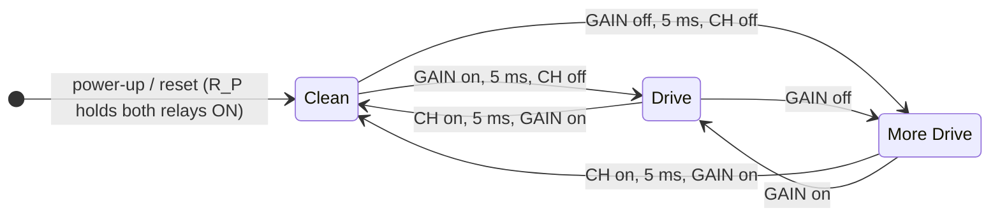
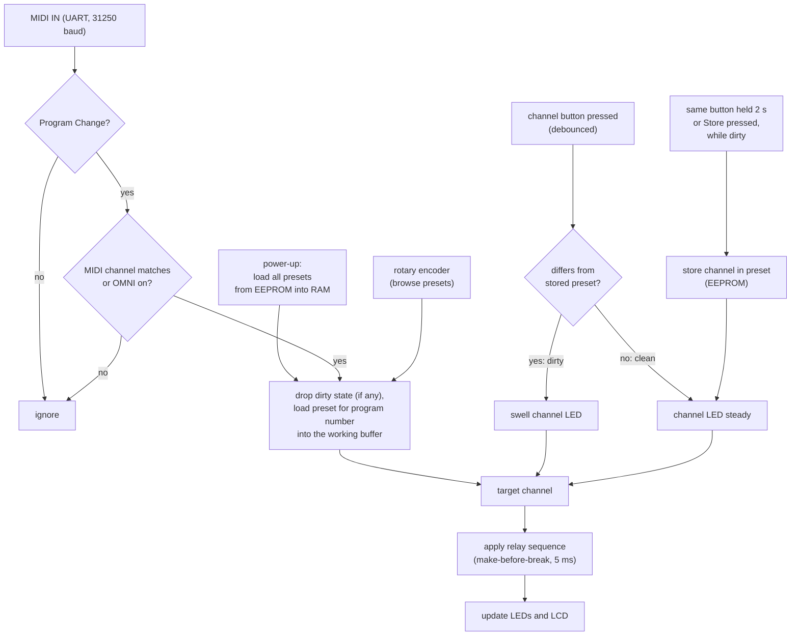

# fenderswitch

A programmable, MIDI-controllable channel switcher for Fender™ Hot Rod Deluxe and Deville guitar amps.

## Overview

These amps ship with a simple footswitch for picking one of three channels: **Clean**, **Drive** and **More Drive**. The footswitch connects over a plain mono (TS) cable, and the amp selects the channel based on the voltage it sees on that cable.

fenderswitch replaces that footswitch. Two isolated optical CMOS relays (photorelays) recreate the analog switching of the original pedal:

- **Relay 1 (channel)** switches between **Clean** and **Drive**.
- **Relay 2 (gain)** chooses between **Drive** and **More Drive**.

On the microcontroller side, each relay is just a digital output pin driven HIGH or LOW.

### Front panel

There are three momentary push buttons, one for each channel, so you can select any channel directly. An LED next to each button shows which channel is active:

| Channel    | LED    |
|------------|--------|
| Clean      | green  |
| Drive      | yellow |
| More Drive | red    |

### Presets and MIDI

The microcontroller's EEPROM holds up to **128 presets**, one per MIDI program number. A MIDI IN circuit feeds the microcontroller's UART. When the device receives a **MIDI Program Change**, it loads the preset stored for that program and switches the amp to that channel. This lets you control the amp from an external MIDI pedal or a multi-effects board.

At boot, all presets are loaded from EEPROM into RAM, so switching programs never waits for the EEPROM. Preset *n* is stored in EEPROM byte *n* (bytes 0–127); the bytes above are free for settings such as the MIDI channel.

All programs start out as **Clean**, the factory preset. You change a preset with the channel buttons and store it by holding the button or by pressing **Store** (see [Usage](#usage)).

### Display and controls

An internal LCD shows the current program and its channel. It also shows the configuration menus, for example for setting the MIDI channel and turning OMNI mode on or off. A rotary encoder with a built-in push button lets you move through the menus and browse quickly through the presets. The **Store** button next to it saves a modified preset, and in the menus it confirms the MIDI settings and writes them to EEPROM.

## Features

- Recreates the amp's original 3-channel footswitch using isolated optical CMOS relays
- Three channel buttons with green, yellow and red status LEDs
- 128 presets stored in EEPROM, edited directly with the channel buttons
- MIDI IN: Program Change recalls the matching preset
- Configurable MIDI channel and OMNI mode
- LCD with menus, navigated by a rotary encoder with a push button
- Store button: saves a modified preset with one push, confirms settings in the menus
- Falls back to Clean while the microcontroller is in reset, so a brown-out or watchdog reset never makes the amp jump to its loudest setting

## How the amp's footswitch line works

The amp sends about 27 VAC through an 820 Ω resistor onto the tip of its FOOT SWITCH jack. Each half-cycle carries one piece of information:

- The **positive half-cycle** selects the **channel** (Clean or Drive).
- The **negative half-cycle** selects the **gain** (Drive or More Drive).

Whatever is plugged in clamps each half-cycle either to about one diode drop or leaves it open, in which case zener diodes inside the amp clamp it at about ±10 V. The amp measures the two peak voltages at test points TP32 and TP35 and decides with two comparators. In Clean mode the amp ignores the gain half-cycle, because transistor Q4 locks out More Drive while the Normal channel is active.

fenderswitch works like the amp's front-panel switches: a 1N4148 steering diode sends each half-cycle to its own photorelay, and the photorelay either shorts that half-cycle to the sleeve or leaves it open. This gives the largest noise margins of all switching methods.


Source: Fender schematic 050384 rev. B and footswitch assembly 050419. The voltages below are derived from the schematic and should be measured on your own amp.

## Hardware

| Ref. | Component | Notes |
|------|-----------|-------|
| | Arduino Nano (ATmega328P) | CH340 clone with the old bootloader (uploads at 57600 baud), runs at 5 V |
| | 16x2 character LCD with I2C backpack | Address `0x27` (A0–A2 not jumpered) |
| | Rotary encoder with push button | Bare 5-pin mechanical encoder (EC11 style) |
| R × 2 | 10 kΩ | Encoder: pull-ups from A and B to 5 V |
| | 3 × LED | Green, yellow and red channel indicators, each with a series resistor |
| | 4 × momentary push button | One per channel, plus Store next to the encoder. Wired to GND, using the internal pull-ups, debounced in firmware |
| U1 | Toshiba TLP222A-2 (or 2 × TLP222A) | Dual photorelay, 60 V, 500 mA, R_ON ≤ 2 Ω. Ch. 1 = channel, ch. 2 = gain |
| Q1, Q2 | BC547 | Relay drivers. Any small-signal NPN works (2N3904, MMBT3904), but check the pinout: BC547 is C-B-E, 2N3904 is E-B-C (flat side facing you) |
| R_F × 2 | 390 Ω, 1/4 W | Relay LED current about 10 mA at 5 V (use 200 Ω at 3.3 V) |
| R_B × 2 | 1 kΩ | Base resistor from the GPIO |
| R_P × 2 | 10 kΩ | Base pull-up to V_DD, keeps the relay ON during reset |
| D1, D2 | 1N4148 | Half-cycle steering. D1 anode to tip, D2 cathode to tip |
| TVS | SMBJ15CA (bidirectional) | ESD and plug-in transients across tip and sleeve |
| J | 5-pin DIN socket (180°) | MIDI IN |
| U | H11L1 or Sharp PC900V | MIDI optocoupler with Schmitt-trigger output, isolates the MIDI sender's ground. Same pinout: 1 anode, 2 cathode, 4 V_O, 5 GND, 6 V_CC |
| R × 2 | 220 Ω, 10 kΩ | MIDI: 220 Ω in series with the opto LED, 10 kΩ output pull-up to 5 V (keep it weak, see [Sharing the UART](#sharing-the-uart-with-usb)) |
| D | 1N4148 | MIDI: across the opto LED, against reverse voltage |
| C | 100 nF | MIDI: optocoupler decoupling, close to pin 6 |
| | Mono (TS) jack (6.35 mm) | Goes to the amp's footswitch input |
| | <!-- power supply --> | |

The KiCad 9 project is in [hardware/fenderswitch/](hardware/fenderswitch/). It was bootstrapped from [hardware/fenderswitch.py](hardware/fenderswitch.py) with [circuit-synth](https://github.com/circuit-synth/circuit-synth), which places the parts and connects them by net labels; the wiring is then done by hand in KiCad, and the `.kicad_sch` file is the source of truth. The channel buttons, the Store button and the power supply are not in it yet.

> **Availability:** Toshiba has announced end-of-life for the TLP222A. Buy spares, or use a part with a similar spec (60 V, ≥ 100 mA, R_ON ≤ 2–3 Ω), for example the Panasonic AQY212EH. Check the pinout and LED current before swapping.

Requirements for any replacement switch element: ≥ 60 V off-state voltage, ≥ 100 mA on-state current (the line carries about 46 mA peak), on-resistance ≤ 2 Ω (the Clean state has the smallest noise margin) and current flow in both directions. Phototransistor optocouplers, CMOS analog switches like the 4066 and plain low-side MOSFETs do not meet these.

### Relay drivers

The microcontroller doesn't drive the photorelay LEDs directly. Each relay gets an NPN low-side driver:


R_P pulls the base up, so the relay LED is **ON whenever 5 V is present**, even while the microcontroller is in reset, booting or has its pin unconfigured. To switch the relay OFF, the firmware drives the pin LOW, and the R_B / R_P divider holds the base at about 0.45 V, well below turn-on.

With both relays ON the amp is in Clean mode, the quiet state. So a brown-out or watchdog reset doesn't make the amp switch to a loud channel. Only a complete loss of power still gives Drive + More Drive, because the photorelays are normally open.

Keep the microcontroller side (5 V, GND, transistors) and the amp side (tip, sleeve, D1, D2, TVS, relay outputs) apart on the board. With a separate power supply the photorelays keep the two grounds isolated, which avoids ground loops and hum.

### MIDI IN

The MIDI IN circuit follows the MIDI 1.0 electrical specification (2014):


- The sender drives a current loop through its own resistors, the 220 Ω and the optocoupler LED, about 5 mA. The 1N4148 protects the LED against reverse voltage.
- DIN pin 2 (shield) stays unconnected on the receiver, so the sender's ground never reaches ours.
- The optocoupler's Schmitt-trigger output goes LOW while the LED is lit, which matches the UART polarity, so no inverter is needed.
- Keep the pull-up at 10 kΩ, so the USB chip can still drive D0 for uploads (see [Sharing the UART with USB](#sharing-the-uart-with-usb)).

### Rotary encoder

A bare mechanical encoder with push button connects to the Nano with two 10 kΩ pull-ups. It has five pins: **A**, **C** and **B** on one side (C, the common contact, in the middle) and the two **SW** pins on the other.


- The encoder only shorts A and B to C, and the push button shorts its two SW pins. So C and one SW pin go to GND, and A, B and SW need pull-ups.
- A and B get **10 kΩ to 5V**. That's stiffer than the Nano's internal pull-ups (20–50 kΩ), so the lines pick up less noise and their edges are faster, and the contacts carry about 0.5 mA, enough to keep them clean. SW is only polled, so the internal pull-up is enough there.
- **A** (CLK in the code) must be on D2 or D3, because only those pins have an external interrupt (INT0 and INT1). B (DT) and SW are polled and can be on any digital pin.
- The firmware turns on the internal pull-ups on A and B as well. They sit in parallel with the 10 kΩ (about 8 kΩ in total) and keep the encoder working if a resistor is missing.
- If you still see stray steps, the encoder datasheets suggest an RC filter per signal: 10 kΩ in series to the pin and 10 nF from the pin to GND. The firmware already filters bounce, so this is optional.
- If turning right goes to the previous program, swap the A and B wires.

How the firmware decodes the signals is explained in [docs/rotary_encoder.md](docs/rotary_encoder.md).

### Prototype: LEDs instead of relays

For prototyping, the relay stages (driver, photorelay and amp side) are replaced by two plain LEDs, one on OUT_CH and one on OUT_GAIN. Each LED is wired from the pin through a 220–330 Ω resistor to GND, like the channel LEDs. A lit LED means "relay ON" (closed), so the LEDs show the [switching states](#channel-switching-states) directly:

| Channel    | OUT_CH LED | OUT_GAIN LED |
|------------|------------|--------------|
| Clean      | on         | on           |
| Drive      | off        | on           |
| More Drive | off        | off          |

The firmware drives the pins exactly as it would drive the real relay stages. Two things differ from the final hardware:

- There is no R_P pull-up, so both LEDs are **off** while the microcontroller is in reset or its pins are still Hi-Z. The real relays are ON in that state. The LEDs show only what the firmware drives, not the reset fallback.
- The 5 ms make-before-break steps are too short to see. To check the order of a switching sequence, watch the pins with a logic analyzer, or build with a much longer delay, for example `build_flags = -DRELAY_SETTLE_MS=500` in [platformio.ini](platformio.ini).

### Wiring

| Nano pin | Connected to | Notes |
|----------|--------------|-------|
| D0 (RX) | MIDI IN: optocoupler output (pin 4) | UART, 31250 baud. Shared with the USB chip, see below |
| D2 | Encoder A (CLK) | External interrupt, so A must be on D2 or D3 |
| D4 | Encoder B (DT) | |
| D5 | Encoder SW | "Enter" button |
| D6 | Green LED | Clean |
| D7 | Yellow LED | Drive |
| D8 | Red LED | More Drive |
| A4 (SDA) | LCD SDA | I2C |
| A5 (SCL) | LCD SCL | I2C |
| D9 | OUT_CH: R_B of Q1, relay 1 (channel) | HIGH / Hi-Z = relay ON |
| D10 | OUT_GAIN: R_B of Q2, relay 2 (gain) | HIGH / Hi-Z = relay ON |
| A0 | Clean button | To GND, `INPUT_PULLUP` |
| A1 | Drive button | To GND, `INPUT_PULLUP` |
| A2 | More Drive button | To GND, `INPUT_PULLUP` |
| A3 | Store button | To GND, `INPUT_PULLUP` |
| 5V / GND | LCD VCC, R_F, R_P, encoder pull-ups, and GND for all modules (including encoder C and SW) | |

Don't use pins that the microcontroller actively drives LOW during boot for OUT_CH and OUT_GAIN.

### Sharing the UART with USB

On the Nano, the USB chip (CH340) is connected to D0 (RX) and D1 (TX) through 1 kΩ resistors. MIDI IN only uses RX, so:

- **Serial output keeps working.** `Serial.print()` goes out on TX to the USB chip as before. Both directions share one baud rate, so the serial monitor runs at 31250 baud (`monitor_speed = 31250`).
- **Uploading works with MIDI IN connected.** The optocoupler's open-collector output and the USB chip's TX form a wired-AND on RX: either one can pull the line LOW. This only works because the opto's pull-up is weak (10 kΩ): the USB chip pulls the line to about 0.45 V through its 1 kΩ. With a strong pull-up, for example 470 Ω, the line stays at about 3.4 V and uploads fail.
- **No MIDI data while uploading.** Both sources share one line, so incoming MIDI would corrupt the upload. Stop the MIDI sender or unplug the MIDI cable.

### Channel switching states

"ON" means the photorelay is closed.

| Channel    | Relay 1 (OUT_CH) | Relay 2 (OUT_GAIN) | Expected TP32 | Expected TP35       |
|------------|------------------|--------------------|---------------|---------------------|
| Clean      | ON               | ON (don't care)    | ≈ +0.5 V      | ≈ −0.5 V (ignored)  |
| Drive      | OFF              | ON                 | ≈ +9.7 V      | ≈ −0.5 V            |
| More Drive | OFF              | OFF                | ≈ +9.7 V      | ≈ −9.9 V            |

TP32 and TP35 are test points inside the amp, where it measures the positive and negative peaks of the footswitch line. The amp's thresholds are about +1.1 to +1.4 V for the channel and about −4.1 to −4.9 V for the gain (both with hysteresis).

### Switching sequence and timing

The amp's peak detectors charge fast (820 Ω × 0.22 µF ≈ 0.2 ms) but discharge slowly (about 0.1 s). If a relay is open by mistake for even 1 ms and that gap falls on a mains peak, the amp jumps to the wrong mode for 50–100 ms, which you hear as a blip. So the firmware must never create an unintended "open" state and switches **make-before-break**. The TLP222A needs up to 2 ms to turn on, so wait **at least 5 ms** between the two steps:

| Target     | OUT_CH | OUT_GAIN | Order |
|------------|--------|----------|-------|
| Clean      | ON     | ON       | 1. OUT_CH = ON, 2. wait 5 ms, 3. OUT_GAIN = ON |
| Drive      | OFF    | ON       | 1. OUT_GAIN = ON, 2. wait 5 ms, 3. OUT_CH = OFF |
| More Drive | OFF    | OFF      | 1. OUT_GAIN = OFF (still locked out if coming from Clean), 2. wait 5 ms, 3. OUT_CH = OFF |

Rule of thumb: when leaving Clean, set the gain first and then the channel. When entering Clean, close the channel relay first.



Between Drive and More Drive only the gain relay changes, because the channel relay stays OFF in both.

A full channel change takes 20–100 ms on the amp side anyway, because of the slow discharge. The firmware doesn't need to be faster than that.

Firmware notes:

- In `setup()`, write HIGH to OUT_CH and OUT_GAIN **before** setting them to `OUTPUT`, so the relays stay ON through the switch from Hi-Z to output.
- Start with the preset of program 1 (Clean on a fresh EEPROM).
- Enable the watchdog, so a hung microcontroller resets into Clean.
- Debounce the buttons in software (about 30 ms).

## Firmware flow



## Testing

Bench test before connecting to the amp:

1. Measure the voltage across R_F and divide by R_F to get the LED current. Expect 9–11 mA when ON and about 0 when OFF.
2. With the amp unplugged, measure the relay outputs with an ohmmeter. Expect about 1–2 Ω when ON and open when OFF. Mind the D1 / D2 orientation if you measure from tip to sleeve.
3. Hold the Nano in reset with its reset button. Both relays must read ON.

Then on the amp, at low volume:

1. Measure TP32 and TP35 in every mode and compare them with the [switching states](#channel-switching-states). Clean must give TP32 clearly below 1.0 V.
2. Check the amp's front-panel LED: off for Clean, yellow for Drive, red for More Drive.
3. Step through all transitions repeatedly and listen for blips.
4. Unplug the switcher's power while the amp is on, and check which mode results.

> **Safety:** TP32 and TP35 are inside the amp, next to B+ voltages above 400 V, and the filter capacitors stay charged after switch-off. Discharge and measure before touching anything, use insulated probes, and keep one hand away from the chassis.

## Building and flashing

The project uses [PlatformIO](https://platformio.org/).

```sh
pio run                 # build
pio run -t upload       # flash to /dev/ttyUSB0
pio device monitor      # serial monitor at 31250 baud (the MIDI rate)
```

Adjust `upload_port` / `monitor_port` in [platformio.ini](platformio.ini) if your board shows up elsewhere.

The schematics in [docs/](docs/) are generated with [schemdraw](https://schemdraw.readthedocs.io/). After changing [docs/schematics.py](docs/schematics.py), re-render them:

```sh
pip install schemdraw
python docs/schematics.py
```

## Usage

### Selecting a program

Send a MIDI Program Change, or browse the presets with the rotary encoder: turn right for the next program, left for the previous one. Browsing wraps around, so turning right from program 128 gets you to program 1 and vice versa. The device loads the preset for that program and switches the amp to the stored channel. The LCD shows the current program (1–128) and its channel. While you turn the encoder only the LCD follows; the amp switches once the encoder has rested for 300 ms (`BROWSE_SETTLE_MS`), so it doesn't jump through every channel on the way.

### Editing a preset

All 128 presets are initialized to **Clean** in the EEPROM. This is the **factory preset**.

1. Press one of the three channel buttons, for example **Drive**. The amp switches to that channel right away.
2. If the new channel differs from the one stored in the preset, its LED **swells** (fades up and down) and the LCD shows a `*` after the channel, for example `P12  Drive*`. This means the preset is **dirty**: the current state is modified but not saved.
3. Press the button of the stored channel to go back to it. The preset is clean again and the LED lights steadily.
4. To keep the change instead, **hold the same channel button for 2 seconds**, or **press Store** once. The new channel is written to the preset in EEPROM and the LED stops swelling.

A program change while the preset is dirty, whether by MIDI Program Change or with the encoder, drops the modified state without saving it. The preset keeps its stored channel.

### Menu mode

Press the encoder's push button to enter menu mode, and press it again to leave. In menu mode, turning the encoder doesn't change the program, and **Store** confirms the settings and writes them to EEPROM. The menus themselves (MIDI channel, OMNI) are still to come.

<!-- More: MIDI channel / OMNI menu, other controls. -->

## Code structure

| File | Purpose |
|------|---------|
| [src/main.cpp](src/main.cpp) | Setup and main loop |
| [include/Task.hpp](include/Task.hpp) | Cooperative tasks (protothread style) and the round-robin scheduler, no `delay()` anywhere |
| [include/RotaryEncoder.hpp](include/RotaryEncoder.hpp) | Decodes the rotary encoder (interrupt on CLK) and debounces its push button, explained in detail in [docs/rotary_encoder.md](docs/rotary_encoder.md) |
| [include/LcdBuffer.hpp](include/LcdBuffer.hpp) | Shadow buffer for the 16x2 LCD, writes only the characters that changed |
| [include/AmpChannel.hpp](include/AmpChannel.hpp) | The three amp channels (Clean, Drive, More Drive) |
| [include/Preset.hpp](include/Preset.hpp) | The channel stored for one MIDI program, loads from and flushes to the EEPROM byte of a given program number |
| [include/PresetLoader.hpp](include/PresetLoader.hpp) | All 128 presets in RAM plus the working buffer, dirty tracking and storing |
| [include/OpticalRelay.hpp](include/OpticalRelay.hpp) | Drives the two photorelays, switching make-before-break |
| [include/Led.hpp](include/Led.hpp) | On/off LED with slow/fast blinking, swelling (PWM) and a one-shot flash |
| [include/EncoderTask.hpp](include/EncoderTask.hpp) | Browses the presets with the encoder (right = next program, wraps around), "Enter" toggles menu mode, Store saves a dirty preset. Also shows the working buffer: steady or swelling LED, `*` on the LCD while dirty |
| [include/ChannelTask.hpp](include/ChannelTask.hpp) | The three channel buttons: a press switches the amp right away, holding the current channel's button for 2 s stores a dirty preset |
| [include/Button.hpp](include/Button.hpp) | Debounced push button to GND, with hold detection (channel buttons, Store, the encoder's "Enter") |
| [include/StatsTask.hpp](include/StatsTask.hpp) | Prints loop passes per second over Serial, to spot blocking code. Off by default, turn it on with `-DSTATS_INTERVAL_S=10` in `build_flags` (development only) |

## License

<!-- e.g. MIT -->
