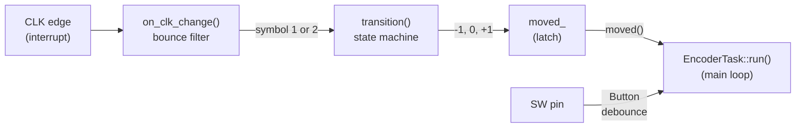
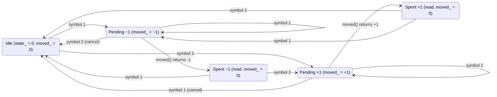

# Rotary encoder

How the `RotaryEncoder` class turns a mechanical encoder's two signal lines and push button into clean "one step left / one step right / Enter" events.

Code: [include/RotaryEncoder.hpp](../include/RotaryEncoder.hpp), [src/RotaryEncoder.cpp](../src/RotaryEncoder.cpp). The class only decodes the hardware. What a step *does* (selecting the next program) is up to [EncoderTask](../include/EncoderTask.hpp).

## Hardware

The encoder is a bare 5-pin part (EC11 style). Its contacts only short the signal pins to GND, so they need pull-ups: 10 kΩ to 5V on A and B on the board, and the internal pull-up (`INPUT_PULLUP`) on SW. The firmware turns on the internal pull-ups on A and B too, so the encoder still works without the external resistors (see the [README](../README.md#rotary-encoder)):

| Pin | Nano | Function |
|-----|------|----------|
| A (CLK) | D2 | Encoder track A |
| B (DT)  | D4 | Encoder track B |
| C       | GND | Common contact of A and B |
| SW      | D5 | Push button ("Enter"), shorts to the other SW pin when pressed |
| SW      | GND | |

A module with its own pull-ups, like the KY-040 (CLK, DT, SW, +, GND), works too: the internal pull-ups then sit in parallel with the module's.

CLK must be on D2 or D3, because those are the Nano's external-interrupt pins (INT0 and INT1). DT and SW are polled and can be on any pin.

The constructor configures the pins and reads the current CLK and DT levels as the starting point for the bounce filter (see [Step 1](#step-1-the-interrupt-handler-on_clk_change)). `setup()` attaches the interrupt itself:

```cpp
static RotaryEncoder encoder{ENC_CLK_PIN, ENC_DT_PIN, ENC_SW_PIN};
static void onEncoderClk() { encoder.on_clk_change(); }
...
attachInterrupt(digitalPinToInterrupt(ENC_CLK_PIN), onEncoderClk, CHANGE);
```

## Quadrature signals

Inside the encoder, two contacts (CLK and DT) open and close as the shaft turns. They are offset by a quarter period, so one of them always changes first. Which one changes first tells the direction.

Turning one way, DT changes **before** CLK:

```
         ┌───────┐       ┌───────┐
DT   ────┘       └───────┘       └────
           ┌───────┐       ┌───────┐
CLK  ──────┘       └───────┘       └──
           ↑       ↑       ↑       ↑     at every CLK edge: CLK == DT
```

Turning the other way, CLK changes before DT:

```
           ┌───────┐       ┌───────┐
DT   ──────┘       └───────┘       └──
         ┌───────┐       ┌───────┐
CLK  ────┘       └───────┘       └────
         ↑       ↑       ↑       ↑       at every CLK edge: CLK != DT
```

So the firmware only needs to look at the moment CLK changes, rising or falling, and compare the two levels:

| At a CLK edge | Symbol | Direction |
|---------------|--------|-----------|
| CLK == DT | 2 | +1 |
| CLK != DT | 1 | −1 |

Which of the two is clockwise depends on how the module is wired. If right and left come out reversed, swap the CLK and DT wires.

Between two CLK edges, DT changes exactly once. That is the key to the bounce filter below.

## Overview



`on_clk_change()` and `transition()` run in **interrupt context**, on every CLK edge. `moved()`, `reset()` and `enter_pressed()` run in the **main loop**, called by `EncoderTask` on every pass. They share `moved_`, which needs some care (see [Interrupts and the main loop](#interrupts-and-the-main-loop)).

## Step 1: the interrupt handler, `on_clk_change()`

```cpp
void RotaryEncoder::on_clk_change()
{
    uint8_t clk = digitalRead(clk_pin_);
    uint8_t dta = digitalRead(dta_pin_);
    if (clk != clk_last_)
    {
        clk_last_ = clk;
        if (dta != dta_last_)
        {
            dta_last_ = dta;
            transition(clk == dta ? 2 : 1);
        }
    }
}
```

Mechanical contacts bounce: for a millisecond or so after the contact closes or opens, the level flips back and forth, and every flip fires the interrupt. The handler filters this with two checks:

1. **Did CLK really change?** `clk != clk_last_` drops interrupts where CLK already bounced back to its previous level by the time the handler reads it.
2. **Did DT change since the last counted edge?** In a real rotation, DT changes exactly once between two CLK edges. While CLK bounces, DT stays put, so `dta != dta_last_` is false for every bounce after the first counted edge.

Only when both are true is the edge counted. `clk_last_` and `dta_last_` then hold the levels at that edge, and the direction symbol goes to `transition()`.

Before the first edge, `clk_last_` and `dta_last_` hold the levels the constructor read from the pins. That matters: if they started at a fixed 0 while both lines idle HIGH, the first CLK edge (falling to 0) would look like "no change", and the second one wouldn't count either because DT would seem unchanged. The first turn after power-up would then be lost.

Example: CLK bounces three times on one edge, with DT steady at 1:

| CLK read | `clk != clk_last_` | `dta != dta_last_` | Result |
|----------|--------------------|--------------------|--------|
| 1 | yes (was 0) | yes (was 0) | **counted**, symbol 2 |
| 0 | yes | no | ignored, but `clk_last_` = 0 |
| 1 | yes | no | ignored, `clk_last_` = 1 |
| 0 | yes | no | ignored |
| 1 (settled) | yes | no | ignored |

The next edge is counted only after DT has changed, which happens on the next real quarter turn.

## Step 2: the state machine, `transition()`

Even with the filter, an occasional wrong symbol gets through, for example when DT bounces at the moment CLK changes. `transition()` adds a second line of defence: a small state machine that remembers the last two symbols and only reports a step when the pattern makes sense.

### State

`state_` holds the last two symbols, two bits each:

```
state_ = (previous << 2) | current        bits 3-2: previous, bits 1-0: current
```

Symbol 0 means **idle** (nothing pending). It only appears as the previous symbol, after the state machine resets itself. Symbol 3 never occurs.

```cpp
state_ = ((state_ << 2) | direction) & 0x0f;   // shift in the new symbol, keep two
moved_ += movements[state_];
if (moved_ == 0) {
    state_ = 0;                                // back to idle
}
```

### The `movements` table

`movements[state_]` says what the pair (previous, current) adds to `moved_`. It is a 4×4 table, written in the code with one row per previous symbol:

```cpp
static const int8_t movements[16] = {
//  current:   0   1   2   3      previous:
               0, -1, +1,  0,  // 0 (idle)
               0,  0, +1,  0,  // 1
               0, -1,  0,  0,  // 2
               0,  0,  0,  0,  // 3 (never occurs)
};
```

Only four entries matter:

| Previous | Current | Adds | Meaning |
|----------|---------|------|---------|
| 0 (idle) | 1 | −1 | first edge after idle: **latch** −1 |
| 0 (idle) | 2 | +1 | first edge after idle: **latch** +1 |
| 1 | 1 | 0 | still turning the −1 way: already latched, don't count again |
| 2 | 2 | 0 | still turning the +1 way: already latched |
| 1 | 2 | +1 | direction reversed: **cancels** the −1 |
| 2 | 1 | −1 | direction reversed: **cancels** the +1 |

A pair only adds something right after idle (latch) or when the direction reverses (cancel). So `moved_` never leaves the range −1 to +1: it is a **latch**, not a counter.

### All states

Together with `moved_` and the reads by `moved()`, this gives five states:



"Spent" means the main loop has read the step: `moved()` cleared `moved_`, but leaves `state_` alone, so the previous symbol is still remembered. From there:

- One more edge in the **same** direction only re-arms: it goes back to idle without reporting anything.
- An edge in the **opposite** direction is reported right away, so changing direction feels immediate.

### Examples

Turning the −1 way, with the main loop reading after every edge (the normal case, since `EncoderTask` polls thousands of times per second):

| Edge | Pair | `moved_` | Then |
|------|------|----------|------|
| 1 | (0,1) | −1 | `moved()` returns −1, `moved_` = 0 |
| 2 | (1,1) | 0 | back to idle, nothing reported |
| 3 | (0,1) | −1 | `moved()` returns −1 |
| 4 | (1,1) | 0 | back to idle |

So continuous rotation yields **one step per two counted CLK edges**.

A bounce that flips the direction for a single edge cancels itself:

| Edge | Pair | `moved_` | Then |
|------|------|----------|------|
| 1 | (0,1) | −1 | |
| 2 | (1,2) | 0 | back to idle, nothing reported |

### Steps per detent

The encoder clicks into detents as it turns. One step per two CLK edges equals one step per full CLK cycle. Whether that is one step per detent depends on the module:

- Many encoders have as many pulses as detents (for example 20 and 20 per turn). Each detent is one full CLK cycle, so **one step per detent**.
- Some variants have twice as many detents as pulses (for example 30 detents, 15 pulses). There, CLK changes once per detent, so it takes **two detents per step**.

If the program changes only every other click, the module is the second kind. `transition()` would then need to report on every counted edge.

## Reading the result: `moved()` and `reset()`

```cpp
int RotaryEncoder::moved()
{
    return (moved_ ? reset() : 0);
}

int RotaryEncoder::reset()
{
    int8_t wrk;
    ATOMIC_BLOCK(ATOMIC_RESTORESTATE)
    {
        wrk = moved_;
        moved_ = 0;
    }
    return wrk;
}
```

`moved()` returns −1, 0 or +1 and clears the latch. Because `moved_` is a latch, a pending step is reported only once, however many edges arrive before the main loop reads it. The main loop must therefore poll **often**. If it polls too rarely while the encoder spins fast, steps get lost: four edges between two reads still give at most one step. `EncoderTask` polls on every loop pass, and nothing in the firmware blocks (see [Task.hpp](../include/Task.hpp)), so this doesn't happen in practice.

## Interrupts and the main loop

The interrupt handler writes `moved_`, and the main loop reads and clears it. Three things keep that safe:

| What | Why |
|------|-----|
| `volatile` on all members the ISR touches | The compiler must re-read them from RAM every time, instead of keeping a stale copy in a register. |
| `moved_` is an `int8_t` | The ATmega328P is an 8-bit CPU. A 2-byte `int` takes two instructions to read, and the interrupt could change it in between. Going from −1 (`0xFFFF`) to 0, the main loop could then see `0x00FF` = 255. One byte is read in a single instruction, so a value can't be half-updated. This also makes the quick `moved_ ? ... : 0` check in `moved()` safe. |
| `ATOMIC_BLOCK` in `reset()` | Reading and clearing are two steps. Without the block, an edge arriving between them would be overwritten by the clear and lost. The block (from avr-libc's `<util/atomic.h>`) disables interrupts for those two instructions. `ATOMIC_RESTORESTATE` re-enables them afterwards only if they were enabled before. An edge that arrives meanwhile is not lost: the interrupt flag stays set and the handler runs right after the block. |

`state_`, `clk_last_` and `dta_last_` are only ever touched by the handler, so they need no extra protection.

The handler itself is short, two `digitalRead()` calls and a table lookup, a few microseconds in total. That matters, because while it runs, other interrupts (`millis()`, the UART receiving MIDI) wait.

## The push button: `enter_pressed()`

The encoder owns a [Button](../include/Button.hpp) for SW, the same class the Store button uses (and later the channel buttons). `enter_pressed()` just forwards to it:

```cpp
bool RotaryEncoder::enter_pressed()
{
    return sw_.pressed();
}
```

The button is polled, not interrupt driven, and debounced in software:

```cpp
bool Button::pressed()
{
    uint8_t raw = digitalRead(pin_);
    uint32_t now = millis();
    if (raw != raw_)
    {
        // Still bouncing: restart the debounce interval.
        raw_ = raw;
        changed_at_ = now;
        return false;
    }
    if (raw == stable_ || now - changed_at_ < BUTTON_DEBOUNCE_MS)
    {
        return false;
    }
    stable_ = raw;
    return raw == LOW;
}
```

Three members track the button:

| Member | Meaning |
|--------|---------|
| `raw_` | level at the previous call |
| `changed_at_` | when `raw_` last changed |
| `stable_` | the debounced level |

Each call:

1. If the level differs from the previous call, the contact is still moving. Restart the timer.
2. If the level hasn't been stable for `BUTTON_DEBOUNCE_MS` (30 ms) yet, or already equals the debounced level, nothing happens.
3. Otherwise, accept the new level. Report `true` if it is LOW (pressed). The release is accepted too, but not reported.

So `enter_pressed()` returns `true` exactly once per press, 30 ms after the contact settles. `now - changed_at_` is computed in unsigned arithmetic, so it stays correct when `millis()` wraps around after about 49 days.

## Known limitations

- **Direction depends on wiring.** Swap CLK and DT if needed (see [Quadrature signals](#quadrature-signals)).
- **Steps per detent depend on the module.** See [Steps per detent](#steps-per-detent).
- **Fast spinning with slow polling loses steps**, because `moved_` is a latch. Not an issue with the current non-blocking main loop.
