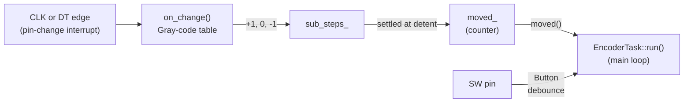

# Rotary encoder

How the `RotaryEncoder` class turns a mechanical encoder's two signal lines and push button into clean "one step left / one step right / Enter" events.

Code: [include/RotaryEncoder.hpp](../include/RotaryEncoder.hpp), [src/RotaryEncoder.cpp](../src/RotaryEncoder.cpp). The class only decodes the hardware. What a step *does* (selecting the next program) is up to [EncoderTask](../include/EncoderTask.hpp).

## Hardware

The encoder is a bare 5-pin part (EC11 style). Its contacts only short the signal pins to GND, so they need pull-ups: 10 kΩ to 5V on A, B and SW on the board. The firmware turns on the internal pull-ups (`INPUT_PULLUP`) on all three too, so the encoder still works without the external resistors (see the [README](../README.md#rotary-encoder)):

| Pin | Nano | Function |
|-----|------|----------|
| A (CLK) | D2 | Encoder track A |
| B (DT)  | D4 | Encoder track B |
| C       | GND | Common contact of A and B |
| SW      | D5 | Push button ("Enter"), shorts to the other SW pin when pressed |
| SW      | GND | |

A module with its own pull-ups, like the KY-040 (CLK, DT, SW, +, GND), works too: the internal pull-ups then sit in parallel with the module's.

CLK and DT both need an interrupt, but only D2 and D3 have an external interrupt (INT0 and INT1), and DT is on D4. So the sketch uses the **pin-change interrupt** of port D instead (PCINT2, covering D0-D7), enabled only for the two encoder pins. Both pins must therefore be on port D (D0-D7). SW is polled and can be on any pin.

The constructor configures the pins and reads the current CLK and DT levels as the starting point for the decoder. `setup()` enables the interrupt itself:

```cpp
static RotaryEncoder encoder{ENC_CLK_PIN, ENC_DT_PIN, ENC_SW_PIN};

static void enablePinChangeInterrupt(uint8_t pin)
{
    *digitalPinToPCMSK(pin) |= bit(digitalPinToPCMSKbit(pin));
    PCIFR = bit(digitalPinToPCICRbit(pin));  // drop a stale pending flag
    *digitalPinToPCICR(pin) |= bit(digitalPinToPCICRbit(pin));
}

ISR(PCINT2_vect) { encoder.on_change(); }
...
enablePinChangeInterrupt(ENC_CLK_PIN);
enablePinChangeInterrupt(ENC_DT_PIN);
```

`PCINT2_vect` fires on any edge of any enabled port D pin. The Arduino core doesn't use it (only SoftwareSerial would), and the hardware UART on D0/D1 has its own interrupt, so MIDI IN is not affected.

## Quadrature signals

Inside the encoder, two contacts (CLK and DT) open and close as the shaft turns. They are offset by a quarter period, so exactly one of them changes at a time, and which one changes first tells the direction.

The firmware combines both levels into a 2-bit code, `(DT << 1) | CLK`. Turning the shaft walks this code through a **Gray-code cycle**, where neighbouring codes differ in one bit:

```
      detent                          detent
DT   ──────┐               ┌──────────────
           └───────────────┘
CLK  ──────────┐               ┌──────────
               └───────────────┘
code    11   10      00      01     11        -1 way: 11 → 10 → 00 → 01 → 11
```

The +1 way runs the same cycle backwards: `11 → 01 → 00 → 10 → 11`.

Which of the two is clockwise depends on how the module is wired. If right and left come out reversed, swap the CLK and DT wires.

At rest in a detent, both contacts are open, so both pins read HIGH on the pull-ups: code `11`. One click is one full cycle, four transitions.

## Overview



`on_change()` runs in **interrupt context**, on every edge of either pin. `moved()`, `reset()` and `enter_pressed()` run in the **main loop**, called by `EncoderTask` on every pass. They share `moved_`, which needs some care (see [Interrupts and the main loop](#interrupts-and-the-main-loop)).

## The interrupt handler, `on_change()`

```cpp
void RotaryEncoder::on_change()
{
    uint8_t code = read_code();                       // (DT << 1) | CLK
    state_ = ((state_ << 2) | code) & 0x0f;           // (previous << 2) | current
    sub_steps_ += movements[state_];

    if (code == DETENT_CODE)
    {
        if (sub_steps_ >= 2 && moved_ < INT8_MAX)        ++moved_;
        else if (sub_steps_ <= -2 && moved_ > -INT8_MAX) --moved_;
        sub_steps_ = 0;
    }
}
```

### The `movements` table

`state_` holds the previous and the current code, two bits each, so it is an index from 0 to 15 into a 4×4 table, with one row per previous code:

```cpp
static const int8_t movements[16] = {
//  current:  00  01  10  11      previous:
               0, -1, +1,  0,  // 00
              +1,  0,  0, -1,  // 01
              -1,  0,  0, +1,  // 10
               0, +1, -1,  0,  // 11
};
```

| Transition | Adds | Meaning |
|------------|------|---------|
| one bit changed, along the −1 cycle | −1 | a quarter step the −1 way |
| one bit changed, along the +1 cycle | +1 | a quarter step the +1 way |
| no change (diagonal) | 0 | the interrupt fired, but the level bounced back before it was read |
| both bits changed (anti-diagonal: `00 ↔ 11`, `01 ↔ 10`) | 0 | an edge was missed, so the direction is unknown |

### Bounce

Contact bounce makes one pin flip back and forth for a millisecond or so, while the other pin stays put. In the code, that is a walk back and forth between two neighbouring codes, so its +1s and −1s cancel out. No separate bounce filter is needed.

### Settling at the detent

The quarter steps add up in `sub_steps_`. Each time the code arrives at the detent (`11`), they are settled and `sub_steps_` is cleared:

| `sub_steps_` at the detent | Meaning | Step |
|----------------------------|---------|------|
| +4 / −4 | a full click | +1 / −1 |
| ±3, ±2 | a full click with one missed edge | +1 / −1 |
| ±1, 0 | turned partway and back, or wiggled around the detent | none |

Settling at the detent, rather than counting every four quarter steps, keeps the steps aligned with the clicks: after a missed edge, the count is corrected at the next detent instead of staying one quarter off for good.

### Examples

| Codes after the detent | Quarter steps | `sub_steps_` at `11` | Step |
|------------------------|---------------|----------------------|------|
| `10 00 01 11` | −1 −1 −1 −1 | −4 | −1 |
| `10 11 10 11 10 00 01 00 01 11` (bounce on CLK, then on DT) | | −4 | −1 |
| `10 01 11` (missed `00`) | −1 0 −1 | −2 | −1 |
| `10 00 10 11` (half a click and back) | −1 −1 +1 +1 | 0 | none |

### Steps per detent

This assumes one full Gray-code cycle per detent, with the detent at `11`, which is the common EC11 type (for example 20 pulses and 20 detents per turn). Some variants have twice as many detents as pulses and also rest at `00`. With those, it takes **two clicks per step**, since only `11` is settled. If the program changes only every other click, settle at `00` as well.

## Reading the result: `moved()` and `reset()`

```cpp
int RotaryEncoder::moved()
{
    return (moved_ ? reset() : 0);
}

int RotaryEncoder::reset()
{
    int8_t wrk;
    ATOMIC_BLOCK(ATOMIC_RESTORESTATE)
    {
        wrk = moved_;
        moved_ = 0;
    }
    return wrk;
}
```

`moved_` is a **counter**: it adds up the steps until the main loop reads them, clamped to −127…+127. `moved()` returns them, negative for the −1 way, and clears the counter. So a slow main loop pass doesn't lose steps. It just gets several at once, and `EncoderTask` moves that many programs.

## Interrupts and the main loop

The interrupt handler writes `moved_`, and the main loop reads and clears it. Three things keep that safe:

| What | Why |
|------|-----|
| `volatile` on all members the ISR touches | The compiler must re-read them from RAM every time, instead of keeping a stale copy in a register. |
| `moved_` is an `int8_t` | The ATmega328P is an 8-bit CPU. A 2-byte `int` takes two instructions to read, and the interrupt could change it in between. Going from −1 (`0xFFFF`) to 0, the main loop could then see `0x00FF` = 255. One byte is read in a single instruction, so a value can't be half-updated. This also makes the quick `moved_ ? ... : 0` check in `moved()` safe. |
| `ATOMIC_BLOCK` in `reset()` | Reading and clearing are two steps. Without the block, a step arriving between them would be overwritten by the clear and lost. The block (from avr-libc's `<util/atomic.h>`) disables interrupts for those two instructions. `ATOMIC_RESTORESTATE` re-enables them afterwards only if they were enabled before. An edge that arrives meanwhile is not lost: the interrupt flag stays set and the handler runs right after the block. |

`state_` and `sub_steps_` are only ever touched by the handler (and the constructor, before the interrupt is enabled), so they need no extra protection.

The handler itself is short, two `digitalRead()` calls and a table lookup, a few microseconds in total. That matters, because while it runs, other interrupts (`millis()`, the UART receiving MIDI) wait.

## The push button: `enter_pressed()`

The encoder owns a [Button](../include/Button.hpp) for SW, the same class the Store button uses (and later the channel buttons). `enter_pressed()` just forwards to it:

```cpp
bool RotaryEncoder::enter_pressed()
{
    return sw_.pressed();
}
```

The button is polled, not interrupt driven, and debounced in software on the leading edge:

```cpp
bool Button::pressed()
{
    uint32_t now = millis();
    if (now - changed_at_ < BUTTON_DEBOUNCE_MS)
    {
        // Still bouncing from the last change.
        return false;
    }
    uint8_t raw = digitalRead(pin_);
    if (raw == stable_)
    {
        return false;
    }
    stable_ = raw;
    changed_at_ = now;
    return raw == LOW;
}
```

Two members track the button:

| Member | Meaning |
|--------|---------|
| `stable_` | the debounced level |
| `changed_at_` | when `stable_` last changed; while the button is down, when it was pressed |

Each call:

1. If the last accepted change is less than `BUTTON_DEBOUNCE_MS` (30 ms) ago, the contact may still be bouncing. Ignore the pin.
2. If the level equals the debounced level, nothing happens.
3. Otherwise, accept the new level right away and start the lockout. Report `true` if it is LOW (pressed). The release is accepted too, but not reported.

So `enter_pressed()` returns `true` exactly once per press, on the first LOW reading, within one loop pass. A mechanical contact bounces only after it has closed, so the lockout swallows the bounce without delaying the press. `begin()` takes the pin's level at startup as the debounced level, so a button held at power-up doesn't count as a press. `now - changed_at_` is computed in unsigned arithmetic, so it stays correct when `millis()` wraps around after about 49 days.

## Known limitations

- **Direction depends on wiring.** Swap CLK and DT if needed (see [Quadrature signals](#quadrature-signals)).
- **Steps per detent depend on the module.** See [Steps per detent](#steps-per-detent).
- **Both pins must be on port D (D0-D7)**, because the sketch uses the PCINT2 pin-change interrupt.
